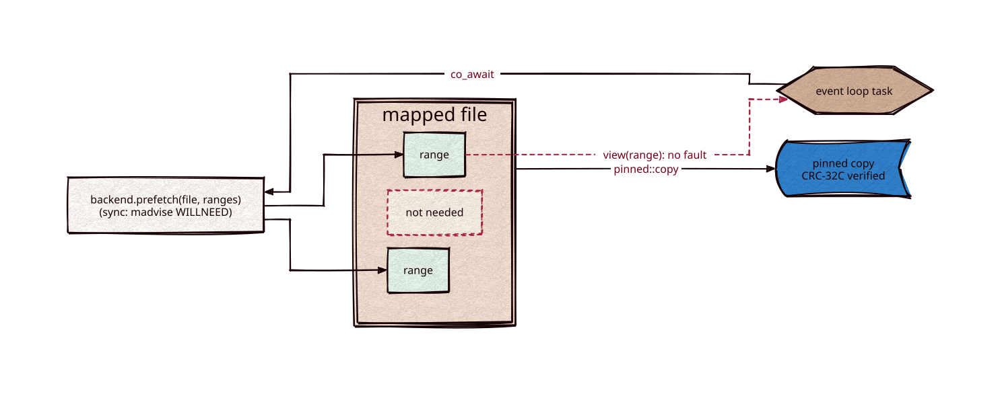

# residency

[](https://github.com/Kronuz/residency/actions/workflows/ci.yml)
[](LICENSE)


Read-only file regions for C++20 code that runs on an event loop: map a file, ask
for the byte ranges a computation is about to read, and `co_await` until they are
resident, so the loop reads memory instead of blocking on a page fault. Small hot
regions can be pinned into owned memory and checksum-verified. Header-only; depends
on [task](https://github.com/Kronuz/task) and [hashes](https://github.com/Kronuz/hashes)
(CRC-32C).



## ✨ Highlights

- `residency::file`: a read-only memory mapping with bounds-checked `view(range)`.
- `residency::pinned::copy(file, range, crc32c)`: copies a region into owned memory
  and verifies its CRC-32C, throwing on a mismatch. For structures that must never
  fault or be read corrupt: term indexes, skip data, document lengths.
- `residency::verified_regions(bytes, regions)`: checksummed regions of mapped bytes;
  `verify(range)` checks each region it overlaps the first time any read touches it
  (one atomic state per region) and returns false on a mismatch, then and after.
- `residency::backend`: the concept every backend implements,
  `task::task<void> prefetch(const file&, std::span<const range>)`.
- `residency::sync_backend`: advises the kernel (`madvise(MADV_WILLNEED)`) and returns
  without suspending. It is the only backend shipped so far; asynchronous ones
  (io_uring on Linux, POSIX AIO on macOS) are planned against the same concept.

## 📦 Installation

Requires a C++20 compiler; CMake 3.14 or newer for the CMake route. CI builds it on
Linux (x86_64, arm64), macOS (arm64, x86_64), and FreeBSD, plus ASan, UBSan, and TSan
builds.

```cmake
include(FetchContent)
FetchContent_Declare(residency
  GIT_REPOSITORY https://github.com/Kronuz/residency.git
  GIT_TAG        main)
FetchContent_MakeAvailable(residency)

target_link_libraries(my_app PRIVATE residency::residency)
```

## 🚀 Quick start

```cpp
#include "residency.hh"

auto f = residency::file::open("segment.sx");
residency::sync_backend io;

task::task<std::uint64_t> evaluate(const residency::file& f, std::vector<residency::range> postings) {
    co_await io.prefetch(f, postings);   // resident (as far as the backend promises)
    std::uint64_t n = 0;
    for (auto r : postings) { n += f.view(r).size(); }
    co_return n;
}
```

## 🎯 When to use it

- ✅ Event-loop code that reads mapped files: index segments, posting lists.
- ❌ Writable mappings, or Windows: read-only, POSIX only.

### Limits

- The synchronous backend only advises: a first touch can still fault and block.
- POSIX only (mmap, madvise).

## 📚 Documentation

- [AGENTS.md](AGENTS.md): repository map and invariants.

## 🛠️ Building and testing

```sh
cmake -S . -B build && cmake --build build && ctest --test-dir build
```

## 🤝 Contributing

Issues and pull requests are welcome. Read [AGENTS.md](AGENTS.md) first. CI must
pass on every platform.

## 📄 License

MIT, Copyright (c) 2026 Germán Méndez Bravo. See [LICENSE](LICENSE).
